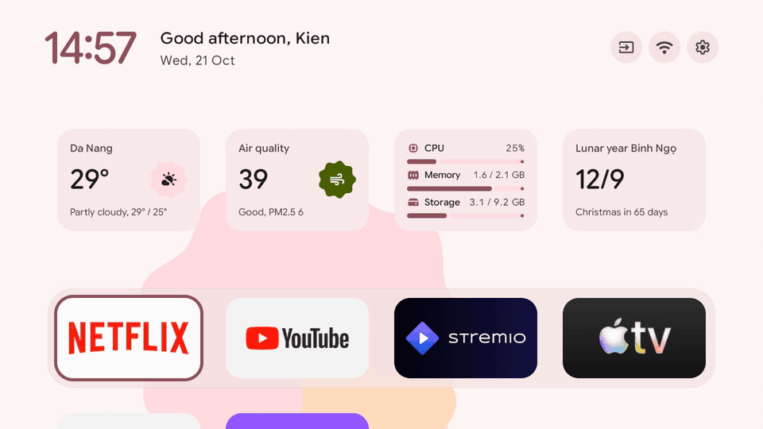
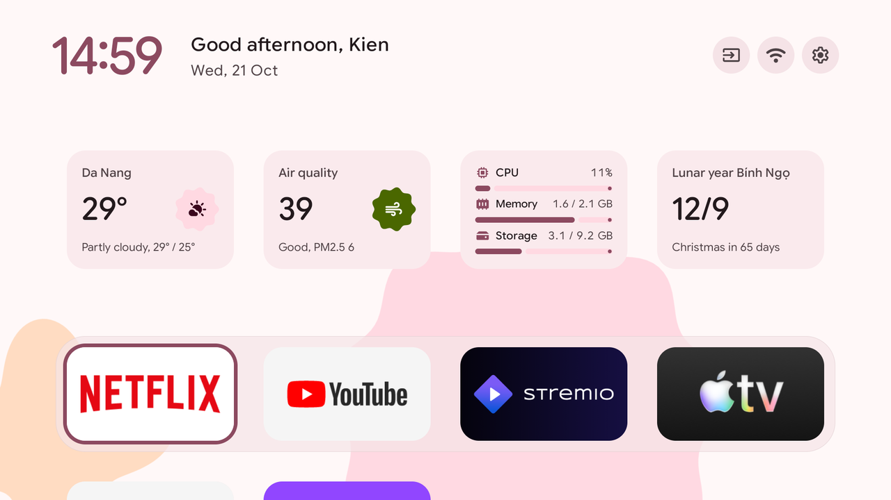
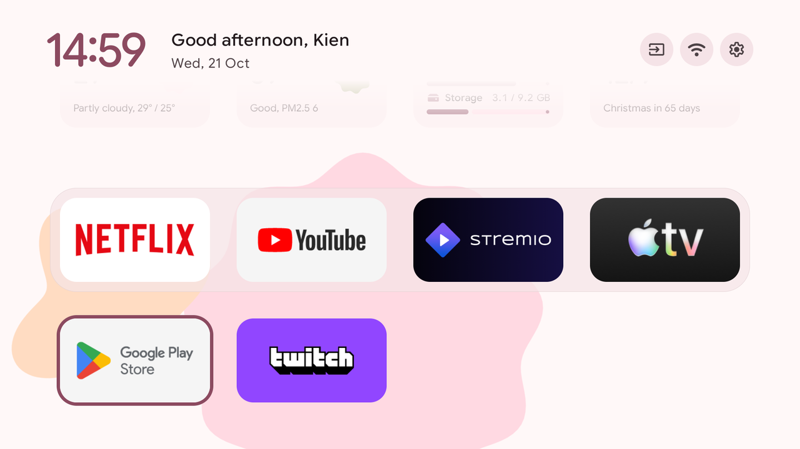
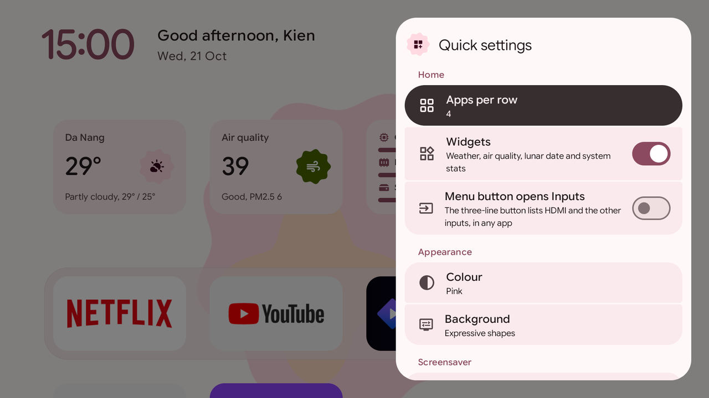
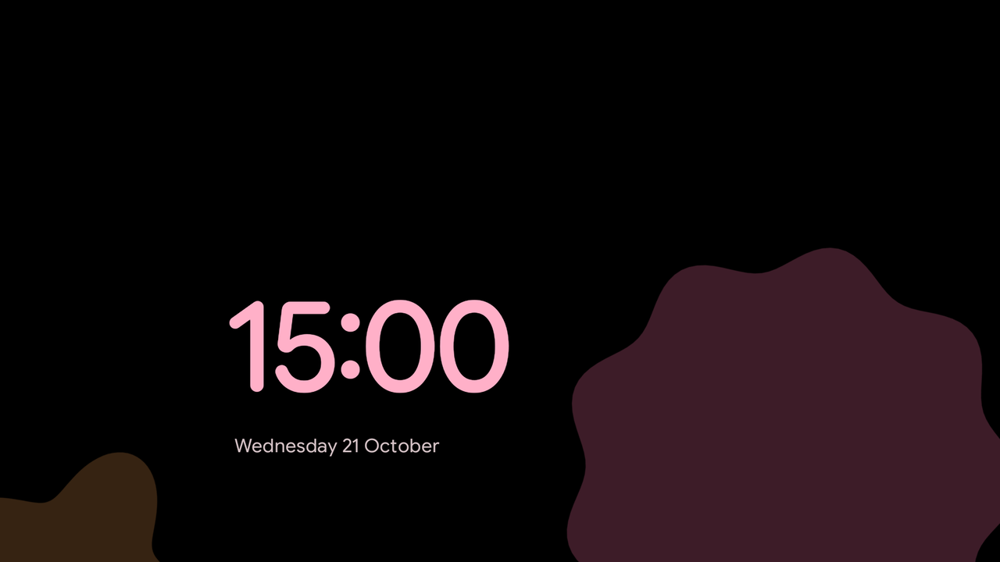

<h1 align="center">freeTV</h1>

<p align="center"><b>A cleaner Android TV. No root.</b> Debloat it over Wi-Fi and give it a Material 3 Expressive home screen.</p>

<p align="center">
  <a href="#quick-start">Quick start</a>&nbsp;&nbsp;&nbsp;&nbsp;
  <a href="packages/debloat-lists/">Supported TVs</a>&nbsp;&nbsp;&nbsp;&nbsp;
  <a href="docs/prompt.md">Agent prompt</a>
</p>

<p align="center">
  
</p>

- **Debloat:** lists for 108 TV models switch off telemetry, ads and preloads. Nothing is uninstalled,
  and every change can be put back.
- **Launcher:** a dock and app grid, widgets for weather, air quality, the system and the lunar
  calendar, a sky that follows the weather, and a clock screensaver.
- **Remote:** the Input, Netflix, YouTube and gear buttons keep working once the stock home is gone.

## Quick start

1. On the TV, turn on USB debugging: About, press Build 7 times, then Developer options.
2. Paste this into a coding agent such as Claude Code or Codex:

   ```text
   Read https://github.com/kienmai160598/freeTV/blob/main/docs/prompt.md and follow it.
   My TV: <brand and model, or "find out">. Its IP: <ip, or "find it on my network">.
   ```

   Or run it yourself (Go 1.27+, JDK 17, Android SDK 34):

   ```bash
   git clone https://github.com/kienmai160598/freeTV && cd freeTV
   export TV_HOST=192.168.1.50
   scripts/tvctl probe                                   # accept the prompt on the TV
   scripts/tvctl disable packages/debloat-lists/<your-tv>/debloat.txt
   make install
   ```

3. When you are done, turn debugging off and reboot the TV.

- Undo: `scripts/tvctl restore packages/debloat-lists/<your-tv>/debloat.txt`
- Change the look: `scripts/tvctl theme packages/themes/<theme>`
- Windows: use `scripts\tvctl.ps1`

## Screens

<p align="center">
  
  
  
  
</p>

## Under the hood

- `apps/tvctl`: a Go CLI with its own ADB client.
- `apps/launcher`: km-launcher, in Java.
- `packages/`: the debloat lists and themes.
- Conventions are in [`AGENTS.md`](AGENTS.md); `make check` runs what CI runs.

## Credits

- MIT licence, forked from [Gathin23/cleanyourtv](https://github.com/Gathin23/cleanyourtv), whose
  contributors wrote the debloat lists.
- Google Sans Flex: SIL Open Font License. Material Color Utilities: Apache 2.0.
